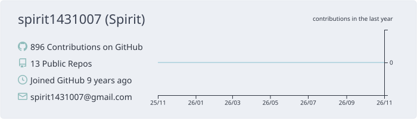
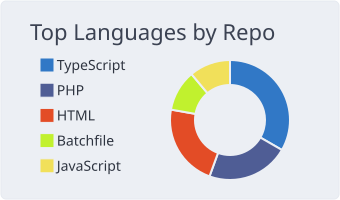
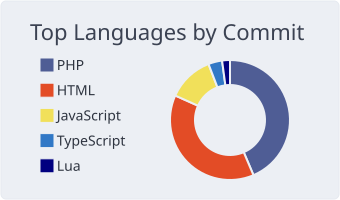
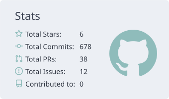
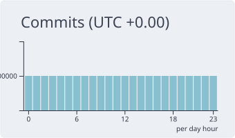

[](https://git.io/spiritx)
[](https://git.io/spiritx) [](https://git.io/spiritx)
[](https://git.io/spiritx) [](https://git.io/spiritx)

<!--START_SECTION:waka-->

```txt
From: 24 October 2026 - To: 31 October 2026

Go             6 hrs 2 mins          ███████▒░░░░░░░░░░░░░░░░░   29.18 %
Markdown       5 hrs 16 mins         ██████▒░░░░░░░░░░░░░░░░░░   25.52 %
Other          2 hrs 23 mins         ███░░░░░░░░░░░░░░░░░░░░░░   11.59 %
HTML           1 hr 42 mins          ██░░░░░░░░░░░░░░░░░░░░░░░   08.22 %
JavaScript     1 hr 39 mins          ██░░░░░░░░░░░░░░░░░░░░░░░   07.99 %
```

<!--END_SECTION:waka-->


